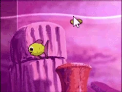
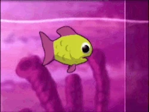
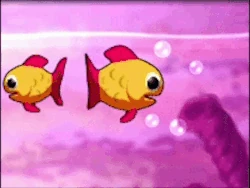
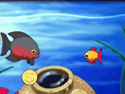

# FDD AquaMystics Game 

## General description
Inspired by the "Insaniquarium" game,  "AquaMystics" plunges players into an underwater realm. Here, players nurture aquatic creatures and defend against mysterious threats..

### Dynamics
Resource Management: Gain money, spend it to care for your creatures, make more money!

Strategic Defense: Defend your creatures from threats.

Care and Nurture: Keep your creatures healthy and growing.

Risk and Reward: Deciding whether to save currency for bigger upgrades or spend on immediate needs.

## Functional requirements
Feeding Mechanism:
- Players tap/click to feed creatures. This costs currency.
- Food falls down slowly and dissapears when it hits the bottom.

Creatures:
- The player can buy a creature.
- The creature stays within the aquarium.
- Creatures can get hungry.
- When hungry they will swim to falling food. If not hungry, they won't.
- If it gets no food, it dies.
- After enough food, a creature can grow.
- A creature can't grow beyond a certain limit.
- Some creatures might behave in different ways like swiming around, staying at the bottom of the aquarium, being really fast or attacking threats.

Currency:
- Creatures generate currency if they are big enough.
- Currency falls down like food and dissapears if it hits the ground.
- Currency can be collected by clicking it.
- The bigger the fish, the more currency it makes.
- Currency can buy the following:
  - Upgrade your food quality.
  - Buy more creatures.
  - An idividual food.
  - A damage upgrade.
  - The win condition which finishes the level and unlocks the next level.

Hostiles:
- Hostile creatures can appear randomly.
- Before it appears, you get an indicator and warning that it is about to spawn and where.
- They start chasing your creatures.
- If they touch a creature, it dies.
- You can kill the hostile to by clicking it to deal damage to it.
- There can be unique hostiles like a version that can dash, teleport, shoot projectiles, etc.
  

General game progression:
- The game is level based.
- Each level gets more difficult.
- The type of creatures and hostiles can vary from level to level.
- Winning a level rewards the player with currency that is not relevant to the levels.
- The player can spend this currency in a universal shop.
- This universal shop will allow the player to buy minor upgrades or unlocks like:
  - Starting every level with better food quality.
  - Starting every level with more starting currency.
  - Cosmetic changes to the aquarium background.

## Non-functional requirements

### Performance
* The game should not lag or reduce below 60 frames per second, even while the player and enemies are shooting.

--- 
# Refinement of each requirement
Refine each requirement and include drawings below.