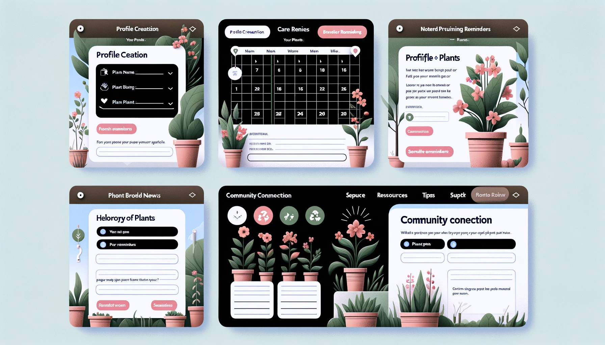

# How-to-Take-Care-of-My-Plants App

## Overview
An app designed to provide personalized care schedules, reminders, and tips for indoor gardening enthusiasts.

**Product owners (client): Anke / Dennis**

## User Stories

### General Users
- As a user, I want to create a profile for each of my plants with all pertinent details.
- As a user, I need to get watering, and prune reminders to ensure proper care for my plants.
- As a user, I would like to have a library of plants with care instructions at my fingertips.
- As a user, I want to track my plant's growth with a photo diary.
- As a user, I expect to connect with other plant enthusiasts for advice and tips.

## Page Layouts
A moodboard with some ideas for the page layouts:

The layout of the pages will be similar to the mood board. 
The color scheme will be green/white/pink and black. 
The font will be a sans-serif font like Open Sans.

### layout pages

#### Plant Search Page
- Form for searching for plant by its name or other details.
- Option to add it to my plants' library.

<table>
  <tr>
    <td style="font-weight: bold">Search for Plant Page</td>
  </tr>
  <tr>
    <td style="font-style: italic">Navigation</td>
  </tr>
  <tr>
    <td><input placeholder="search for plant"> <a>search</a>&nbsp;&nbsp;&nbsp;&nbsp;<a>plant recognition</a></td>
  </tr>
  <tr>
    <td>[Result 1: Image and Details] <a>add</a></td>
  </tr>
  <tr>
    <td>[Result 2: Image and Details] <a>add</a></td>
  </tr>
  <tr>
    <td>[Result 3: Image and Details] <a>add</a></td>
  </tr>
  <tr>
    <td>...</td>
  </tr>
  <tr>
    <td><a>show filters</a></td>
  </tr>
</table>

---

#### My Plants Page
- Details about the plant.
- Detailed care guide.
- Timeline with previous photos.
- Option to upload or take a photo.

<table>
  <tr>
    <td colspan="2" style="font-weight: bold">My Plants Page</td>
  </tr>
  <tr>
    <td style="font-style: italic" colspan="1">Navigation</td>
    <td><a>&lt;</a> previous plant ... next plant <a>&gt;</a></td>
  </tr>
  <tr>
    <td rowspan="5">[Latest image]</td>
    <td>Plant Name</td>
  </tr>
  <tr>
    <td>Species</td>
  </tr>
  <tr>
    <td>Care Details</td>
  </tr>
  <tr>
    <td><textarea placeholder='extra info by user ...' /></td>
  </tr>
    <tr>
    <td><a>Delete plant</a></td>
  </tr>
  <tr>
    <td colspan="2" style="height: 150px;text-align:center"> <a>&lt;</a> [Images showing development of plant] <a>&gt;</a> </td>
  </tr>
  <tr>
    <td colspan="2" style="text-align: right"><a>Add picture</a></td>
  </tr>
</table>

---

#### Reminder Setup Page
- Schedule interface with suggested watering frequency.
- Schedule interface with suggested prune frequency.

<table>
  <tr>
    <td style="font-weight: bold">Watering and Pruning Reminders Page</td>
  </tr>
  <tr>
    <td style="font-style: italic">Navigation</td>
  </tr>
  <tr>
    <td>Calendar View</td>
  </tr>
  <tr>
    <td>Recent Reminders</td>
  </tr>
</table>

---

#### Community Forum Page
- Bulletin board for discussions.
- Categories for different plant care topics.
- Interaction features like comments and likes.

<table>
  <tr>
    <td style="font-weight: bold">Community Forum Page</td>
  </tr>
  <tr>
    <td style="font-style: italic">Navigation</td>
  </tr>
  <tr>
    <td>Forum/Message Board</td>
  </tr>
</table>

---

### Admin Dashboard Page
- Moderate messages and comments.

<table>
  <tr>
    <td style="font-weight: bold">Community Forum Page</td>
  </tr>
  <tr>
    <td style="font-style: italic">Navigation</td>
  </tr>
  <tr>
    <td>Forum/Message Board with option to delete</td>
  </tr>
</table>

## Technical suggestions
- Us a front-end like VueJS for the user interface.
- A database like MongoDB for data storage.
- API: Integration with Perenual API for plant-related information (https://perenual.com/docs/api).
- API: Integration with PlantCareGarden for plant recognition (https://plantcaregarden.com/apiPage).

### Security Measures
- HTTPS: Secure data transfer using SSL/TLS.
- Validate user input.
- CORS Policy: Restrict cross-origin requests.
- API Rate Limiting: Limit the number of API requests to prevent abuse.

### Suggestions for testing
- Unit tests to test parts of the application
- Integration Testing to ensure that API integrations works seamlessly.
- User Acceptance Testing (UAT): Real-world testing with a group of target users to ensure the app meets the user requirements.

